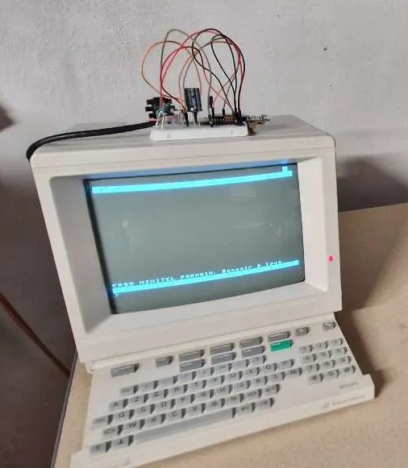
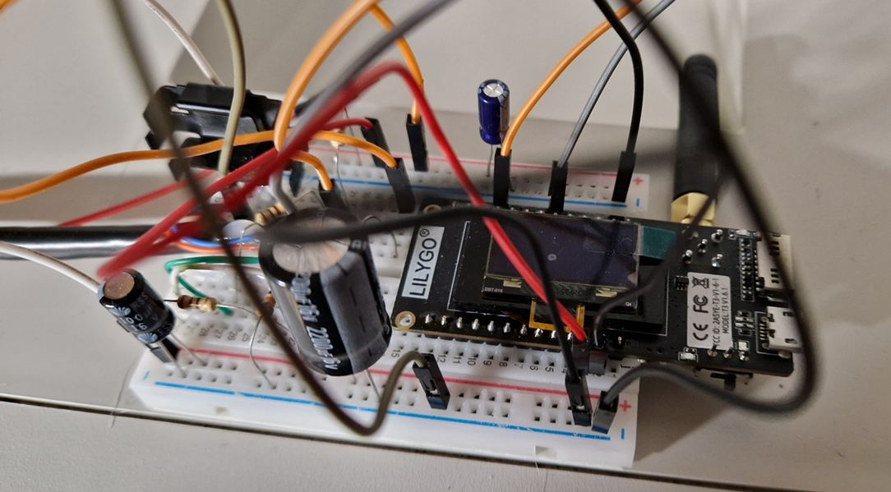
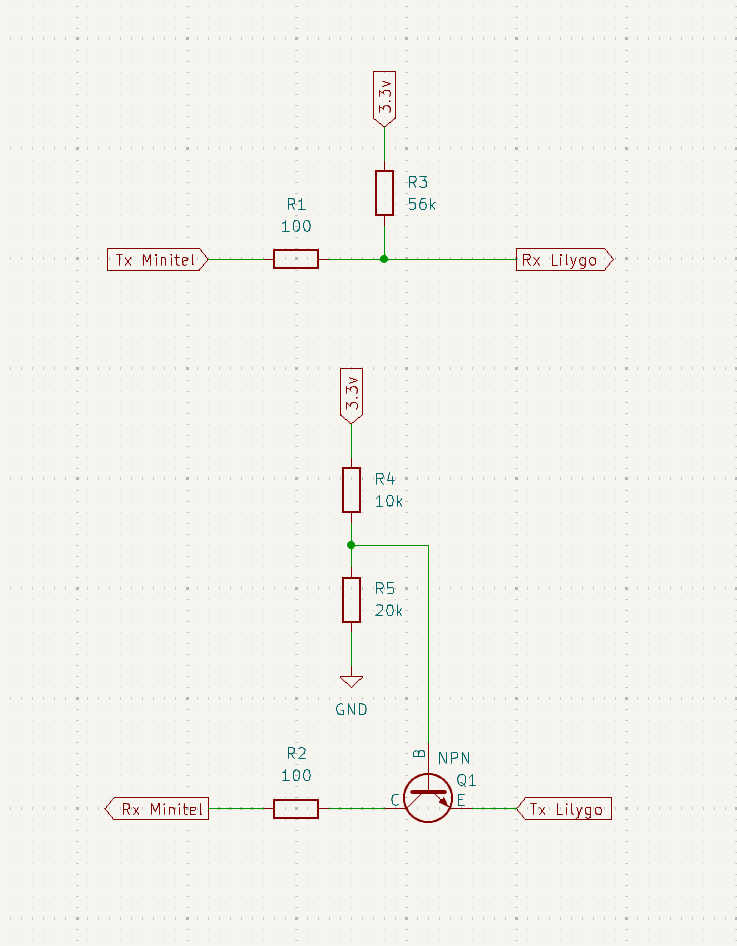

# MeshCore sur Minitel 1B

Un **Minitel 1B** transformé en terminal de messagerie pour le réseau maillé **[MeshCore](https://github.com/meshcore-dev/MeshCore)**, grâce à une carte **LilyGo T3 V1.6.1** (ESP32 + SX1276).

Réalisation : **Capt_Pierrot** et **Jonathan**.

<p align="center">
  
</p>

<p align="center">
  
</p>

## Qu'est-ce que c'est ?

Ce dépôt est un fork de [MeshCore](https://github.com/meshcore-dev/MeshCore) qui ajoute un **environnement de compilation dédié** (`LilyGo_TLora_V2_1_1_6_companion_radio_ble_minitel`) pilotant un Minitel 1B via sa prise péri-informatique, en plus de toutes les fonctions habituelles du firmware « companion » (application mobile en Bluetooth, écran OLED de la carte). Rien n'est retiré à MeshCore : le Minitel vient s'ajouter comme une interface supplémentaire.

Le Minitel sert à **lire et envoyer des messages**, pas à configurer la carte : la majeure partie du paramétrage (réglages radio, canaux, contacts, nom du nœud...) continue de se faire depuis l'**application compagnon MeshCore** sur le téléphone, en Bluetooth.

Nous ne sommes probablement pas les premiers à avoir eu cette idée : d'autres projets et bricolages utilisant du vieux matériel (dont des Minitel) comme interface pour MeshCore circulent déjà dans la communauté. En revanche, à notre connaissance, nous sommes parmi les premiers à publier le code source et les schémas correspondants.

## Fonctionnalités

- Affichage des **canaux** et des **messages privés**, avec accusés de réception et renvoi automatique.
- **Écriture et envoi** de messages depuis le clavier du Minitel.
- Détection automatique du Minitel (vitesse, allumage/extinction), sans jamais bloquer la radio.
- Détails à la demande : nombre de sauts, qualité du signal, heure des messages.
- Sous-menu **« Autres fonctions »** (numéro 900) : tableau de bord (batterie, réglages radio, qualité du dernier signal reçu, état Bluetooth), annonces réseau, bascule de l'écran OLED de la carte, page de crédits.
- **Affichage en 40 ou 80 colonnes** (mode « Mixte » du Minitel), au choix dans le menu 900 ; le réglage est mémorisé par la carte.
- Touches de fonction présentées comme des **boutons** (en vidéo inverse) dans les lignes d'aide, comme sur les services Minitel d'époque.
- LED optionnelle à la réception d'un message (voir plus bas).
- L'application mobile MeshCore continue de fonctionner normalement en parallèle.

## Aperçu des écrans

Affichage en 40 colonnes. Les noms de touches dans les lignes d'aide (`SOMMAIRE`, `GUIDE`, `ENVOI`...) s'affichent en vidéo inverse, comme des boutons.

**Écran de conversation**
```
┌────────────────────────────────────────┐
│ #Public                        1 non lu │
│Alice: Bonjour à tous !                 │
│Bob: Salut Alice, tu es où ?            │
│MonNoeud: Je teste mon Minitel sur le   │
│réseau MeshCore                         │
│...                                     │
│ SOMMAIRE menu  GUIDE détails Reste 116 │
│> Ceci est mon message en cours de fra_ │
│                                        │
│                                        │
└────────────────────────────────────────┘
```

**SOMMAIRE (liste des conversations)**
```
┌────────────────────────────────────────┐
│ SOMMAIRE - Conversations               │
│  1 #Public                             │
│  2 #Randos                          (2)│
│  3 @Alice                           (1)│
│  4 @Bob                                │
│  5 @Relais-Salon                       │
│ ...                                    │
│ 900 Autres fonctions                   │
│ Numéro puis ENVOI ouvrir      page 1/3 │
│ SUITE RETOUR pages  SOMMAIRE sortir    │
│                                        │
│Numéro : 3_                             │
└────────────────────────────────────────┘
```

**Autres fonctions (tableau de bord, numéro 900)**
```
┌────────────────────────────────────────┐
│ SOMMAIRE - Autres fonctions            │
│ Informations                           │
│  Batterie       4.02V                  │
│  Fréquence      869.525 MHz            │
│  Radio          SF11  BW250kHz  CR5    │
│  Puissance TX   20 dBm                 │
│  Taille entête  1 octet                │
│  Signal reçu    -92 dBm  SNR 7dB       │
│  Téléphone BLE  connecté               │
│────────────────────────────────────────│
│ Réglages                               │
│  1 Annonce : voisins (sans relais)     │
│  2 Annonce : tout le réseau (relayée)  │
│  3 Écran OLED : normal (économie)      │
│  4 Affichage : 40 colonnes   5 Crédits │
│                                        │
│ Numéro puis ENVOI choisir              │
│ SOMMAIRE ou ANNULATION retour          │
│                                        │
│Numéro : 1_                             │
└────────────────────────────────────────┘
```

## Matériel nécessaire

| Élément | Remarque |
|---|---|
| Carte **LilyGo T3 V1.6.1** (ESP32 + SX1276) | Vérifiez la fréquence de votre modèle (868 MHz pour l'Europe). |
| Antenne LoRa adaptée | Toujours la brancher avant d'allumer la carte. |
| Câble USB de données | Certains câbles ne font que la charge. |
| **Minitel 1B** | Prise DIN 5 broches à l'arrière (« péri-informatique »). |
| Fiche DIN mâle 5 broches 180° | Pour se brancher sur le Minitel. |
| 1 transistor NPN **2N2222** | Voir § Câblage. |
| Résistances **56 kΩ**, **10 kΩ**, **20 kΩ**, **100 Ω ×2** | Voir § Câblage. |
| (Optionnel) 1 LED + résistance 330 Ω – 1 kΩ | Pour l'indicateur de réception, voir plus bas. |
| (Optionnel) 1 régulateur **LDO** (sortie 5 V) | Pour alimenter la carte depuis le Minitel (DIN 5), voir § Câblage. |
| Un téléphone avec l'application **MeshCore** | Android ou iOS. |

## Câblage

<p align="center">
  
</p>

| Broche DIN | Signal | À relier à |
|---|---|---|
| **1** | RX Minitel (entrée) | Collecteur de **Q1 (NPN 2N2222)**, via **100 Ω** |
| — | — | Émetteur de Q1 → **GPIO 13** (TX) |
| — | — | Base de Q1 → pont diviseur **10 kΩ vers 3,3 V** / **20 kΩ vers GND** |
| **2** | GND | **GND** de la carte — masse commune indispensable |
| **3** | TX Minitel (collecteur ouvert) | **GPIO 34**, via **100 Ω** — avec tirage **56 kΩ vers 3,3 V** |
| 4 | — | Ne rien brancher |
| 5 | +8,5 V | Optionnel, **uniquement via un régulateur LDO** (voir ci-dessous) |

- La carte peut être alimentée par l'**USB**, par sa **batterie**, ou par le **Minitel lui-même** via la broche DIN 5 (+8,5 V) : dans ce cas, passer **obligatoirement par un régulateur LDO** qui ramène cette tension à **5 V propres** avant de l'envoyer sur la broche 5 V de la carte — celle-ci génère ensuite son propre 3,3 V en interne, utilisé pour les ponts diviseurs. Ne **jamais** relier DIN 5 directement à la carte sans ce régulateur.

## LED optionnelle de réception

La carte fait déjà clignoter brièvement une LED à chaque **émission radio** (broche **GPIO 25**, réglage `P_LORA_TX_LED`). Ce firmware la fait aussi clignoter à la **réception** d'un message (canal ou privé) — rien à câbler pour en profiter.

Pour une LED supplémentaire, plus visible : **GPIO 25 → résistance (330 Ω – 1 kΩ) → anode de la LED → cathode → GND**, en parallèle de la LED déjà présente sur la carte. Pas besoin de rien désactiver ni dessouder.

## Compiler et flasher

```bash
pio run -e LilyGo_TLora_V2_1_1_6_companion_radio_ble_minitel -t upload
```

Nécessite [PlatformIO](https://docs.platformio.org), par exemple via l'extension VS Code.

## Dépannage

- **Des caractères aléatoires apparaissent dans la zone de saisie** : presque toujours le signe d'une alimentation insuffisante. Évitez un régulateur classique (type 7805) : préférez un **LDO**, avec un ou deux condensateurs de découplage en plus. Ça résout le problème dans l'immense majorité des cas.
- **L'écran du Minitel reste bloqué sur son propre sommaire interne** (celui de sa mémoire, pas celui de MeshCore) : éteignez puis rallumez le Minitel. La carte redétecte automatiquement sa présence et reconfigure son routage vers la prise péri-informatique à chaque tentative.
- **En 80 colonnes, certains accents disparaissent** (É, ê, ô...) : c'est une limite du Minitel, dont le mode 80 colonnes ne connaît que é, è, à, ç et ù. Les autres lettres accentuées s'affichent sans accent.

## Licences

- **MeshCore** : [MIT](./license.txt), © Scott Powell / rippleradios.com et contributeurs.
- **[Minitel1B_Hard](https://github.com/eserandour/Minitel1B_Hard)** (pilotage du Minitel) : [GPL v3](https://www.gnu.org/licenses/gpl-3.0.html), © Eric Sérandour.

Texte complet : [LICENSE](./LICENSE) (GPL v3) et [license.txt](./license.txt) (MIT).

## Crédits

- **Capt_Pierrot** — l'idée originale de ce projet lui revient : c'est lui qui a eu l'envie de relier un Minitel à MeshCore, avant de chercher quelqu'un pour coder la partie firmware.
- **Jonathan** — développement du firmware, avec l'assistance de **Claude** (Anthropic, modèles Opus/Sonnet).
- [MeshCore](https://github.com/meshcore-dev/MeshCore) — le projet de réseau maillé sur lequel repose ce fork.
- [Minitel1B_Hard](https://github.com/eserandour/Minitel1B_Hard) d'**Eric Sérandour** — la bibliothèque qui pilote le Minitel.

  *Minitel1B_Hard fournit les primitives bas niveau pour communiquer avec le Minitel (affichage, lecture du clavier, changement de vitesse...). Tout ce qui constitue l'interface MeshCore elle-même — conversations, SOMMAIRE, menus, tableau de bord, etc. — a dû être écrit spécifiquement pour ce projet : ça ne fait pas partie de la bibliothèque d'origine, qui n'a pas vocation à fournir une application de messagerie.*

---

## À propos de MeshCore

MeshCore est une bibliothèque C++ légère pour le routage de paquets multi-sauts sur LoRa, pensée pour des réseaux maillés décentralisés et résilients, fonctionnant sans infrastructure (zones blanches, secours, usage tactique...).

- Documentation complète : https://docs.meshcore.io
- Appli mobile : [Android](https://play.google.com/store/apps/details?id=com.liamcottle.meshcore.android) · [iOS](https://apps.apple.com/us/app/meshcore/id6742354151?platform=iphone) · [Web](https://app.meshcore.nz)
- Dépôt d'origine et support : https://github.com/meshcore-dev/MeshCore
